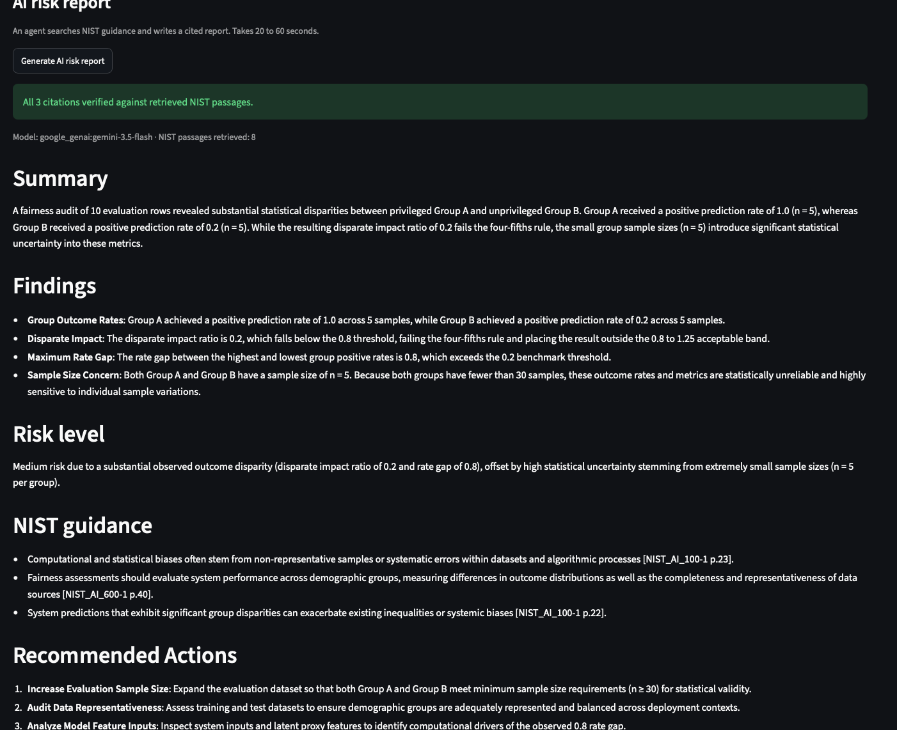
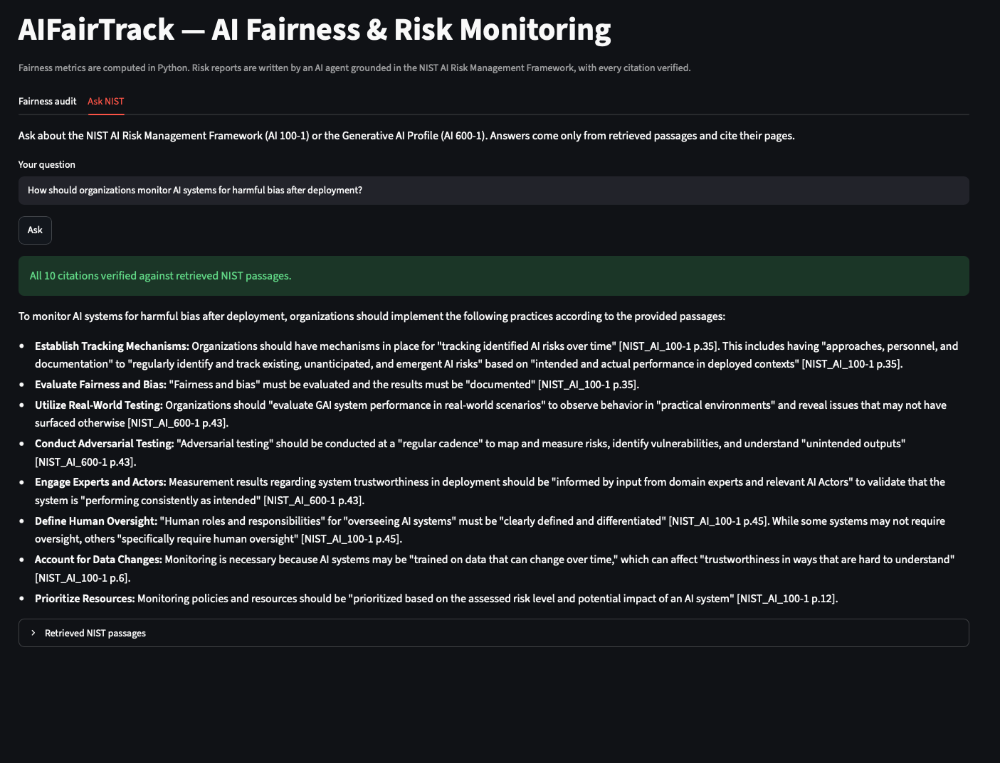
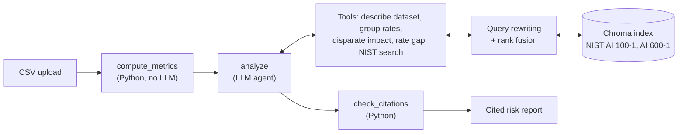

# AIFairTrack

**Agentic AI fairness auditing, grounded in the NIST AI Risk Management Framework.**

**Version 1.0** (October 2026). The original starter-kit version is preserved at [v0.1.0](https://github.com/aliradwan99/AIFairTrack/tree/v0.1.0). See the [changelog](CHANGELOG.md) for what changed.

AIFairTrack audits AI model outputs for bias across demographic groups. Fairness metrics are computed deterministically in Python; an LLM agent then searches the NIST AI RMF and Generative AI Profile, writes a cited risk report, and every citation is automatically verified against the passages the agent actually retrieved.



## What it does

- **Fairness metrics:** group positive rates, disparate impact (four-fifths rule), and max rate gap, computed in Python so numbers can't be hallucinated.
- **Agentic risk report:** a LangGraph agent with tool calling decides what NIST guidance to retrieve and writes a structured report (findings, risk level, guidance, actions, limitations).
- **Citation verification:** every `[NIST_AI_100-1 p.22]`-style citation is checked against the retrieved pages; invented citations are flagged.
- **Ask NIST:** retrieval-augmented Q&A over NIST AI 100-1 and AI 600-1, answering only from retrieved passages, with the same verification.



## Architecture



**Key design decisions**

- **Deterministic where possible.** Metrics and citation checks are plain Python; the LLM only does what requires judgment: choosing what to retrieve and writing the report.
- **The LLM never touches raw data.** Tools take column names and values; Python does the math.
- **Reliability.** A configurable multi-model fallback chain handles outages and free-tier rate limits (429s) with a single wait-and-retry; the vector store is thread-safe for the agent's parallel tool calls.
- **Query rewriting with rank fusion.** User questions are rewritten into NIST terminology by a lightweight model; original and rewritten queries are both searched and merged with reciprocal rank fusion, so a bad rewrite can't fully derail retrieval.

## Evaluation

Every change was measured against a retrieval benchmark: 12 development questions plus a **held-out set of 7** written before any fix was designed, to avoid tuning the system to its own tests. Relevance is judged by evidence terms (e.g. a passage about false AI content must mention "confabulation"), and the benchmark verifies every label exists in the corpus.

| Configuration | Dev hit@4 | Dev MRR | Held-out hit@4 | Held-out MRR |
|---|---|---|---|---|
| MiniLM embeddings (baseline) | 0.750 | 0.607 | — | — |
| + boilerplate filtering | 0.750 | 0.607 | — | — |
| bge-base embeddings | 0.833 | 0.704 | 0.857 | 0.464 |
| **+ concise query rewriting (mean of 3 runs)** | **0.917** | 0.690 | **1.000** | **0.833** |

**Findings worth noting**

- A smaller "search-tuned" embedding model (bge-small) *regressed* every metric; bge-base won.
- An early single-run result (one rewriting strategy beating another) **failed to replicate**. Rewrites from the LLM vary run to run, so configurations are now compared on the mean and range of 3 runs.
- Query rewriting fixed two vocabulary-gap failures (e.g. "false content" vs NIST's "confabulation") and raised held-out MRR from 0.464 to 0.833, at a small cost in dev MRR. This trade-off and a deviation from a pre-registered criterion are documented openly.

All experiments, failures, and decisions are recorded in [`evals/failure_log.md`](evals/failure_log.md), with raw results in `evals/results/`.

**Prompt-injection red team:** in progress. Attacks hide instructions in CSV group values and column names (fake system notices, authority claims, link injection) and are scored by code. Results before and after guardrails will be added here.

## Setup

Requires Python 3.12+ and a free [Google AI Studio](https://aistudio.google.com) API key.

```bash
git clone https://github.com/aliradwan99/AIFairTrack.git
cd AIFairTrack
python3 -m venv venv
source venv/bin/activate
pip install -r requirements.txt

echo "GOOGLE_API_KEY=your-key-here" > .env
python -m aims_track.rag.ingest           # build the NIST vector index (first run downloads the embedding model)
python -m streamlit run aims_track/app.py
```

Models are configurable in `.env` (`LLM_MODEL`, `LLM_FALLBACK_MODELS`, `REWRITE_MODEL`); retrieval via `EMBED_MODEL`, `FILTER_BOILERPLATE`, `QUERY_REWRITE`.

## Running the evaluations

```bash
python evals/retrieval_eval.py --label my_run                                     # dev set
python evals/retrieval_eval.py --cases retrieval_heldout.json --label my_run_ho   # held-out set
python evals/compare.py                                                           # all runs side by side
python evals/redteam.py --label my_attack_run                                     # prompt-injection red team
```

## Limitations and future work

- **Small evaluation sets** (12 dev, 7 held-out); one question moves hit@4 by 0.08 to 0.14.
- **Evidence-term relevance is a lenient proxy:** a passage mentioning a term in passing counts as relevant.
- **Citation verification checks that a cited page was retrieved, not that it supports the claim.** Planned: a quote-faithfulness check confirming quoted text appears in the cited passage.
- **Report-quality evals planned:** the agent sometimes lowers its risk rating because of small samples, conflating severity with confidence (see failure log, G1).
- **Page numbers are PDF page positions,** not the printed page numbers in the NIST documents.
- **Statistical disparity is not proof of discrimination;** reports are decision support, not legal advice.

## Project structure

```
aims_track/
  app.py               Streamlit UI (Fairness audit + Ask NIST tabs)
  agent/               LangGraph pipeline, tools, LLM config and fallback chain
  rag/                 PDF ingestion, retrieval, query rewriting, NIST Q&A
  modules/metrics.py   Fairness metric functions
  examples/            Sample datasets
data/policy_docs/      NIST AI 100-1 and AI 600-1
evals/                 Retrieval benchmark, red team, failure log, results
```

---

Built by [Ali Radwan](https://www.linkedin.com/in/aliradwan): AI red teaming and LLM evaluation.
